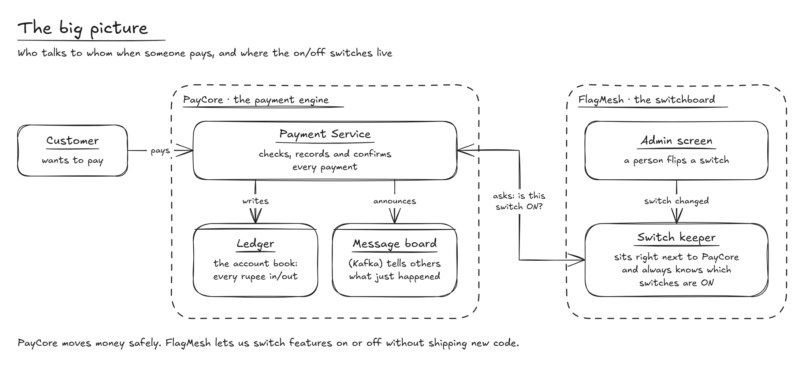
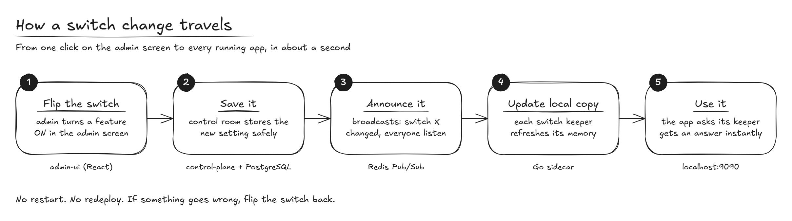

# Project Overview

> **Who this is for:** anyone. You do not need to know how to code to read this page.
> For the technical version, see [System Architecture](02-system-architecture.md).

---

## In one paragraph

This project is made of two products that work together. **PayCore** is a payment engine: it moves money between accounts and makes sure that money is never lost, created out of thin air, or charged twice. **FlagMesh** is a switchboard for features: it lets a person turn a feature on or off in a running app without changing or restarting that app. PayCore uses FlagMesh to decide which of its features are switched on.

---

## The two products

| Product | What it does | Everyday comparison |
|---|---|---|
| **PayCore** | Takes a payment request, checks it, records it in an account book, and tells other systems it happened. | A careful bank clerk. They write every transfer in a ledger and never process the same cheque twice. |
| **FlagMesh** | Stores on/off switches for features and delivers any change to every running app within about a second. | The light switches in a building. You flip a switch and the light changes. Nobody rewires anything. |

---

## The big picture

**Reading the diagram:**

1. A **customer** asks PayCore to make a payment.
2. The **Payment Service** checks the request. It writes the payment into the **Ledger**, the account book.
3. It then posts a notice on the **Message board**, so other systems (for example, a notification service) learn that a payment happened.
4. Separately, a person can flip a switch on the **Admin screen**. The **Switch keeper**, which sits right next to PayCore, learns about the change. When PayCore asks "is this feature on?", the keeper answers instantly.

---

## How a switch change travels

Why this matters: a team can release a new feature to 5% of users, watch it, and then grow to 100%. If something goes wrong, they switch it off in seconds. Nobody waits for a new release.

---

## What happens to a single payment

| Step | What happens | Why it matters |
|---|---|---|
| 1 | The request arrives with a unique **request ID**. | If the customer's phone retries, PayCore recognizes the same ID and does not charge twice. |
| 2 | Money leaves one account and enters another. **Both sides are written together.** | The account book always balances. Money is never created or destroyed. |
| 3 | A "payment done" note is saved **in the same step** as the payment. | The rest of the company is never told about a payment that did not happen. Nor do they miss one that did. |
| 4 | The customer gets a confirmation. | The answer comes quickly. Slower follow-up work happens in the background. |
| 5 | The note is delivered to other systems. If one of them keeps failing, the note goes to a **"problem tray"** for a human to check. | One broken system cannot block everything else. |

---

## Words you will see

| Term | Plain meaning | Everyday example |
|---|---|---|
| **Ledger / double-entry** | Every money movement is written twice: once as money out, once as money in. The two always match. | A notebook where every "minus 500" has a matching "plus 500". |
| **Idempotency** | Doing the same thing twice has the same effect as doing it once. | Pressing a lift button five times still calls one lift. |
| **Transaction** | A group of steps that all succeed together, or all fail together. | A bank transfer is never half done. |
| **Feature flag** | An on/off switch for a feature inside an app. | A light switch for one feature. |
| **Sidecar** | A small helper program that runs right next to an app and answers its questions locally. | A personal assistant sitting at your desk, instead of a call centre in another city. |
| **Cache** | A fast, nearby copy of information. | Keeping your notes on your desk instead of in the archive room. |
| **Message board (Kafka)** | A shared board where systems post events, and other systems read them at their own pace. | A notice board in an office. |
| **Outbox** | A tray where "please announce this" notes wait until they are sent. | An office out-tray. Letters are written first, then posted. |
| **Dead-letter queue (DLQ)** | A tray for messages that keep failing, kept aside for a human to inspect. | The post office's "undeliverable mail" shelf. |
| **Microservice** | A small, independent program that does one job and talks to others over the network. | Separate shops in a mall, each with its own staff. |

---

## Why this project exists

| Goal | How the project serves it |
|---|---|
| Learn real backend engineering | It covers money safety, retries, messaging, caching and concurrency. These are the problems that real payment companies solve. |
| Learn system design hands-on | Every major design choice is written down with its trade-offs. See [System Architecture](02-system-architecture.md). |
| Build a strong portfolio | Two working, documented products that run with one command. Anyone can clone and try them. |

---

## Where things live

| Repository | Contains |
|---|---|
| `paycore` | `payment-service/` (the payment engine) and `deploy/` (files that start everything together) |
| `flagmesh` | `control-plane/` (stores switches), `sidecar/` (switch keeper) and `admin-ui/` (admin screen) |
| `workmesh` | A separate existing project. It is not part of this work, but it could use FlagMesh later. |

---

**Next:** [System Architecture](02-system-architecture.md) · [Data Model](03-data-model.md) · [Project Plan](04-project-plan.md)
