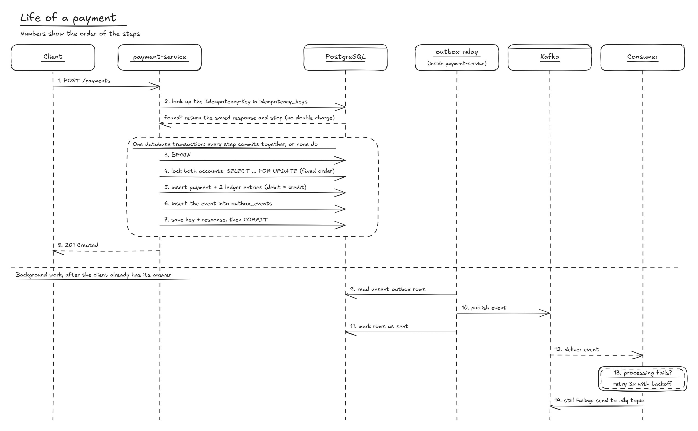

# System Architecture

> **Audience:** engineers and reviewers. Plain-language version: [Project Overview](01-project-overview.md).

---

## 1. Components

| Component | Repo | Tech | Responsibility |
|---|---|---|---|
| `payment-service` | paycore | Spring Boot, Java (LTS) | REST API for payments, idempotency, double-entry ledger, transactional outbox, outbox relay |
| PostgreSQL `paycore_db` | paycore | PostgreSQL | Source of truth for accounts, payments, ledger, idempotency keys, outbox |
| Kafka | paycore (`deploy/`) | Apache Kafka (KRaft) | Delivers payment events to consumers. Holds the dead-letter topic. |
| Event consumers | paycore | Spring Kafka | React to payment events, retry with backoff, and send poison messages to the DLQ |
| `control-plane` | flagmesh | Spring Boot | CRUD for flags, audit log, publishes flag changes |
| PostgreSQL `flagmesh_db` | flagmesh | PostgreSQL | Source of truth for flags, rules and audit log |
| Redis | flagmesh | Redis Pub/Sub | Pushes flag changes to every sidecar |
| `sidecar` | flagmesh | Go | Serves flag lookups on `localhost:9090` from an in-memory cache |
| `admin-ui` | flagmesh | React | Screen for operators to view and change flags |

---

## 2. Architecture diagram

**Communication summary**

| From → To | Style | Protocol | Notes |
|---|---|---|---|
| Client → payment-service | Sync | HTTPS / JSON | Every write must carry an `Idempotency-Key` header. |
| payment-service → PostgreSQL | Sync | JDBC | Payment, ledger, outbox and idempotency rows are written in **one** transaction. |
| outbox relay → Kafka | Async | Kafka protocol | At-least-once delivery. |
| Kafka → consumers | Async | Kafka protocol | Consumer groups. Failed messages are retried, then sent to `payments.events.dlq`. |
| payment-service → sidecar | Sync | HTTP on `localhost:9090` | Short timeout. Falls back to safe defaults. |
| control-plane → Redis | Async | `PUBLISH flag-updates` | Fire-and-forget push. |
| sidecar → control-plane | Sync | HTTP | Full snapshot on startup and every 60 s. This heals any missed messages. |
| admin-ui → control-plane | Sync | REST / JSON | |

---

## 3. Payment request lifecycle

**Guarantees this flow gives:**

- **No double charge.** A retried request with the same `Idempotency-Key` returns the stored response. The primary key on `idempotency_keys.idem_key` stops two concurrent duplicates from both succeeding.
- **Books always balance.** Each payment writes one DEBIT and one CREDIT of equal amount, inside the same transaction.
- **No lost or phantom events.** The event row is committed together with the payment. Kafka is only touched after the commit.
- **No deadlocks between transfers.** Both account rows are always locked in a fixed order, sorted by account ID.

---

## 4. Flag update lifecycle

| Phase | What happens |
|---|---|
| Startup | The sidecar calls the control-plane for a full snapshot. It then subscribes to the Redis channel `flag-updates`. |
| Change | The operator edits a flag in admin-ui. The control-plane saves it, increments `version`, writes an audit row, and then publishes the new flag to Redis. |
| Propagation | Every sidecar receives the message. It applies the message only if the version is newer than the one it holds. |
| Read | The app calls `GET localhost:9090/flags/{key}`. The answer comes from memory, so there is no network hop. |
| Self-healing | Every 60 s the sidecar re-fetches the snapshot. This covers messages lost while Redis was unreachable. |

---

## 5. Key design decisions and trade-offs

| # | Decision | Chosen | Instead of | Why | Cost we accept |
|---|---|---|---|---|---|
| 1 | Repo layout | 2 repos (`flagmesh`, `paycore`) | One monorepo, or one repo per service | Clear product boundary. The shared flag contract (Java + Go) stays in one place. | Cross-repo changes need two commits. |
| 2 | Flag delivery to apps | Sidecar on localhost | SDK library inside each app | Works for any language. One cache per host. The app stays simple. | One extra process to run and watch. |
| 3 | Flag change transport | Redis Pub/Sub | Kafka, or polling only | Changes are tiny, rare and need low latency. Pub/Sub is the simplest fit. | Messages are fire-and-forget. Snapshot resync and versions cover the gaps. |
| 4 | Event publishing | Transactional outbox | Writing to the DB, then publishing to Kafka (dual write) | A dual write can lose events or publish events for payments that never committed. | Small delay. Consumers must handle duplicates. |
| 5 | Outbox relay | Polling scheduler | CDC (Debezium) | Easy to understand and debug while learning. | Polling load on the DB. Higher latency than CDC. |
| 6 | Money records | Double-entry ledger | A single `balance` column | Full audit trail. Anyone can reconcile and prove correctness. | Two extra rows per payment. |
| 7 | Idempotency storage | PostgreSQL, same transaction | Redis | The key and the payment commit atomically. There is no gap between them. | Slightly slower than an in-memory store. |
| 8 | Concurrency on accounts | Pessimistic lock (`SELECT ... FOR UPDATE`) in a fixed order | Optimistic locking only | Hot accounts see heavy contention. Retry storms would hurt. Fixed order prevents deadlocks. | Lower throughput on the same account. |
| 9 | Concurrency on flags | Optimistic (`version` column) | Pessimistic locks | Flag edits are rare and conflicts are unlikely. | The losing editor gets a conflict error and retries. |
| 10 | Money type | `BIGINT` in minor units | `DOUBLE` or `DECIMAL` | Exact integer math. No rounding surprises. | Currency formatting is handled in code. |
| 11 | Poison messages | Bounded retries, then DLQ | Retrying forever | One bad message must not block a partition. | A DLQ needs monitoring and a replay tool. |
| 12 | Service granularity | PayCore is one modular service | Splitting ledger, payments and notifications into separate services | Real microservice boundaries already exist between PayCore and FlagMesh. Extra splits add cost and teach little more. | Modules must keep clean package boundaries. |

---

## 6. Failure scenarios

| What fails | Effect | Recovery |
|---|---|---|
| Sidecar down or slow | payment-service times out quickly (~50 ms) and uses its default flag values. | Restart the sidecar. It reloads the snapshot. |
| Redis down | Sidecars keep their last known flags. New changes do not propagate. | The periodic snapshot resync catches up once the control-plane is reachable. |
| control-plane down | Flags cannot be edited. Sidecars keep serving from memory. | Restart. No data loss. |
| Kafka down | Payments still succeed. Outbox rows pile up with `status = NEW`. | The relay keeps retrying and drains the backlog when Kafka returns. |
| Consumer bug | Messages fail and are retried, then moved to the DLQ. The main topic keeps flowing. | Fix the bug. Replay messages from the DLQ. |
| PostgreSQL (paycore) down | payment-service returns `503`. No partial writes happen. | Clients retry with the same `Idempotency-Key`. That retry is safe. |

---

## 7. Out of scope (for now)

Real bank or card-network integration · user authentication and multi-tenancy · multi-region deployment · Kubernetes · currency conversion.

---

**See also:** [Data Model](03-data-model.md) · [Project Plan](04-project-plan.md)
