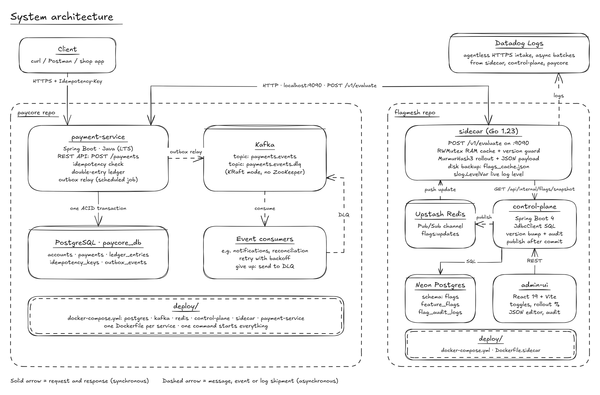

# System Architecture

> **Audience:** engineers and reviewers. Plain-language version: [Project Overview](01-project-overview.md).

---

## 1. Components

| Component | Repo | Tech | Responsibility |
|---|---|---|---|
| `payment-service` | paycore | Spring Boot, Java (LTS) | REST API for payments, idempotency, double-entry ledger, transactional outbox, outbox relay |
| PostgreSQL `paycore_db` | paycore | PostgreSQL | Source of truth for accounts, payments, ledger, idempotency keys, outbox |
| Kafka | paycore (`deploy/`) | Apache Kafka (KRaft) | Delivers payment events to consumers. Holds the dead-letter topic. |
| Event consumers | paycore | Spring Kafka | React to payment events, retry with backoff, and send poison messages to the DLQ |
| `control-plane` | flagmesh | Spring Boot 4, Java 21, JdbcClient, Flyway | Flag CRUD with JSON payloads. Records an audit diff in the same transaction. Publishes each change after commit. Serves the full snapshot. |
| Neon PostgreSQL, schema `flags` | flagmesh (managed) | PostgreSQL | Source of truth for `feature_flags` and `flag_audit_logs` |
| Upstash Redis | flagmesh (managed) | Redis Pub/Sub | Pushes flag changes to every sidecar on channel `flags:updates` |
| `sidecar` | flagmesh | Go 1.23 (~15 MB binary) | Evaluates flags on `POST localhost:9090/v1/evaluate` from RAM in < 0.5 ms. Handles allowlists, MurmurHash3 rollouts and JSON payloads. Keeps a disk backup and a live log level. |
| `admin-ui` | flagmesh | React 19 + Vite | Toggles, rollout slider, JSON payload editor, audit diff drawer |
| `deploy/` | flagmesh | Docker Compose | `docker-compose.yml` and `Dockerfile.sidecar` run FlagMesh locally |
| Datadog Logs | external | Agentless HTTPS intake | Receives batched JSON logs from the sidecar, control-plane and payment-service |

---

## 2. Architecture diagram

**Communication summary**

| From → To | Style | Protocol | Notes |
|---|---|---|---|
| Client → payment-service | Sync | HTTPS / JSON | Every write must carry an `Idempotency-Key` header. |
| payment-service → PostgreSQL | Sync | JDBC | Payment, ledger, outbox and idempotency rows are written in **one** transaction. |
| outbox relay → Kafka | Async | Kafka protocol | At-least-once delivery. |
| Kafka → consumers | Async | Kafka protocol | Consumer groups. Failed messages are retried, then sent to `payments.events.dlq`. |
| payment-service → sidecar | Sync | HTTP `POST /v1/evaluate` on `localhost:9090` | Sends `flagKey` + `userId`. Short timeout. Falls back to safe defaults. |
| control-plane → Neon PostgreSQL | Sync | JDBC (JdbcClient) | Row lock, version bump and audit row in one transaction |
| control-plane → Upstash Redis | Async | `PUBLISH flags:updates` | Sent only after the database commit. Fire-and-forget. |
| sidecar → control-plane | Sync | HTTP `GET /api/internal/flags/snapshot` | Full snapshot on startup and every 60 s. This heals any missed messages. |
| admin-ui → control-plane | Sync | REST / JSON | `GET/POST /api/flags`, `PATCH /api/flags/{key}`, `GET /api/flags/{key}/audits` |
| sidecar, control-plane, payment-service → Datadog | Async | HTTPS (logs intake) | Batched JSON logs from an in-memory buffer. A Datadog outage never blocks a request. |

---

## 3. Payment request lifecycle

**Guarantees this flow gives:**

- **No double charge.** A retried request with the same `Idempotency-Key` returns the stored response. The primary key on `idempotency_keys.idem_key` stops two concurrent duplicates from both succeeding.
- **Books always balance.** Each payment writes one DEBIT and one CREDIT of equal amount, inside the same transaction.
- **No lost or phantom events.** The event row is committed together with the payment. Kafka is only touched after the commit.
- **No deadlocks between transfers.** Both account rows are always locked in a fixed order, sorted by account ID.

---

## 4. Flag update lifecycle

| Phase | What happens |
|---|---|
| Startup | The sidecar calls `GET /api/internal/flags/snapshot` and fills its RAM cache and `flags_cache.json`. If the control-plane is unreachable, it loads `flags_cache.json` instead. It then subscribes to the Redis channel `flags:updates`. |
| Change | The operator edits a flag in admin-ui. In one `@Transactional` call, the control-plane locks the flag row (`SELECT ... FOR UPDATE`), sets `version = version + 1`, and writes the before and after JSON to `flag_audit_logs`. An `afterCommit` hook then publishes the change to Redis, so nothing is announced unless PostgreSQL committed. |
| Propagation | Every sidecar receives the message. It applies it only if the version is newer than the one it holds. It then rewrites `flags_cache.json` atomically: it writes a `.tmp` file, then calls `os.Rename`. |
| Read | The app calls `POST localhost:9090/v1/evaluate` with `flagKey` and `userId`. The answer comes from RAM in under 0.5 ms and includes `enabled`, `reason`, `version` and `payload`. |
| Self-healing | Every 60 s the sidecar re-fetches the snapshot. This covers messages lost while Redis was unreachable, or a publish lost between commit and send. |
| Live log level | The `observability.log-level` flag switches log detail between INFO and DEBUG with no restart. The sidecar does this through `slog.LevelVar`, and the Spring services through `LoggingSystem`. |

**Live settings PayCore reads from flags:** `payment.kill-switch` (stop payments, with `retryAfterSeconds`), `payment.rate-limit` (`requestsPerMinute`, `burst` for a Redis token bucket), `payment.fraud-v2` (new fraud check for 25% of users, with `riskScoreThreshold` and `timeoutMs`), and `observability.log-level`.

---

## 5. Key design decisions and trade-offs

| # | Decision | Chosen | Instead of | Why | Cost we accept |
|---|---|---|---|---|---|
| 1 | Repo layout | 2 repos (`flagmesh`, `paycore`) | One monorepo, or one repo per service | Clear product boundary. The shared flag contract (Java + Go) stays in one place. | Cross-repo changes need two commits. |
| 2 | Flag delivery to apps | Sidecar on localhost | SDK library inside each app | Works for any language. One cache per host. The app stays simple. | One extra process to run and watch. |
| 3 | Flag change transport | Redis Pub/Sub (Upstash) | Kafka, or polling only | Changes are tiny, rare and need low latency. Pub/Sub is the simplest fit. | Messages are fire-and-forget. Snapshot resync and versions cover the gaps. |
| 4 | Event publishing | Transactional outbox | Writing to the DB, then publishing to Kafka (dual write) | A dual write can lose events or publish events for payments that never committed. | Small delay. Consumers must handle duplicates. |
| 5 | Outbox relay | Polling scheduler | CDC (Debezium) | Easy to understand and debug while learning. | Polling load on the DB. Higher latency than CDC. |
| 6 | Money records | Double-entry ledger | A single `balance` column | Full audit trail. Anyone can reconcile and prove correctness. | Two extra rows per payment. |
| 7 | Idempotency storage | PostgreSQL, same transaction | Redis | The key and the payment commit atomically. There is no gap between them. | Slightly slower than an in-memory store. |
| 8 | Concurrency on accounts | Pessimistic lock (`SELECT ... FOR UPDATE`) in a fixed order | Optimistic locking only | Hot accounts see heavy contention. Retry storms would hurt. Fixed order prevents deadlocks. | Lower throughput on the same account. |
| 9 | Concurrency on flags | Row lock (`SELECT ... FOR UPDATE`) plus a version bump | Optimistic retry only | The audit diff needs the exact state before the change. The lock makes edits to one flag happen one at a time, so every `old_state` is accurate. | Two people editing the same flag wait for each other briefly. |
| 10 | Money type | `BIGINT` in minor units | `DOUBLE` or `DECIMAL` | Exact integer math. No rounding surprises. | Currency formatting is handled in code. |
| 11 | Poison messages | Bounded retries, then DLQ | Retrying forever | One bad message must not block a partition. | A DLQ needs monitoring and a replay tool. |
| 12 | Service granularity | PayCore is one modular service | Splitting ledger, payments and notifications into separate services | Real microservice boundaries already exist between PayCore and FlagMesh. Extra splits add cost and teach little more. | Modules must keep clean package boundaries. |
| 13 | Data access in control-plane | `JdbcClient` with hand-written SQL | JPA / Hibernate | Full control over `FOR UPDATE`, JSONB mapping (`PGobject`) and the exact queries run. | More code to write. No automatic entity mapping. |
| 14 | Publishing flag changes | `afterCommit` hook straight to Redis | Transactional outbox, as PayCore uses | Flags carry their own version, and the 60 s reconciler repairs a lost publish. An outbox would be extra machinery. | A crash between commit and publish delays that change by up to 60 s. |
| 15 | Rollout bucketing | `murmur3(flagKey + ":" + userId) % 100` | Random choice on each request | Each user always gets the same answer. Raising 20% to 50% keeps the first 20% enabled. | Rollouts are by user, not by request. |
| 16 | Sidecar cold start | Disk backup `flags_cache.json`, written atomically | Requiring the control-plane at startup | A sidecar can restart while the control-plane or Redis is down. | The flags may be stale until the next sync. |
| 17 | Shipping logs | Agentless HTTPS intake from an async buffer | Datadog Agent container | The Agent uses about 250–350 MB of RAM, which crashes free 512 MB containers. The buffer adds under 2 MB. | Logs can be dropped if the buffer fills during a Datadog outage. |
| 18 | Hosting FlagMesh data | Managed Neon PostgreSQL + Upstash Redis | Self-hosting both in Docker Compose | No database operations work, and free tiers are available. | Needs internet access and is subject to free-tier limits. Reads are not affected, because the sidecar answers from RAM. |

---

## 6. Failure scenarios

| What fails | Effect | Recovery |
|---|---|---|
| Sidecar down or slow | payment-service times out quickly (~50 ms) and uses its default flag values. | Restart the sidecar. It reloads the snapshot, or `flags_cache.json`. |
| Redis (Upstash) down | Sidecars keep their last known flags. New changes do not propagate. | The 60 s snapshot reconciler catches up while the control-plane is reachable. |
| control-plane or Neon down | Flags cannot be edited. Sidecars keep serving from RAM. A restarted sidecar boots from `flags_cache.json`. | Restart. No data loss. |
| Crash between commit and Redis publish | The change is saved but not announced. | The 60 s reconciler picks it up. |
| Datadog unreachable | Log batches fail to send. Requests are not affected. | The buffer keeps up to 1,000 log entries. Once it is full, new logs are dropped. |
| Kafka down | Payments still succeed. Outbox rows pile up with `status = NEW`. | The relay keeps retrying and drains the backlog when Kafka returns. |
| Consumer bug | Messages fail and are retried, then moved to the DLQ. The main topic keeps flowing. | Fix the bug. Replay messages from the DLQ. |
| PostgreSQL (paycore) down | payment-service returns `503`. No partial writes happen. | Clients retry with the same `Idempotency-Key`. That retry is safe. |

---

## 7. Out of scope (for now)

Real bank or card-network integration · user authentication and multi-tenancy · multi-region deployment · Kubernetes · currency conversion.

---

**See also:** [Data Model](03-data-model.md) · [Project Plan](04-project-plan.md)
