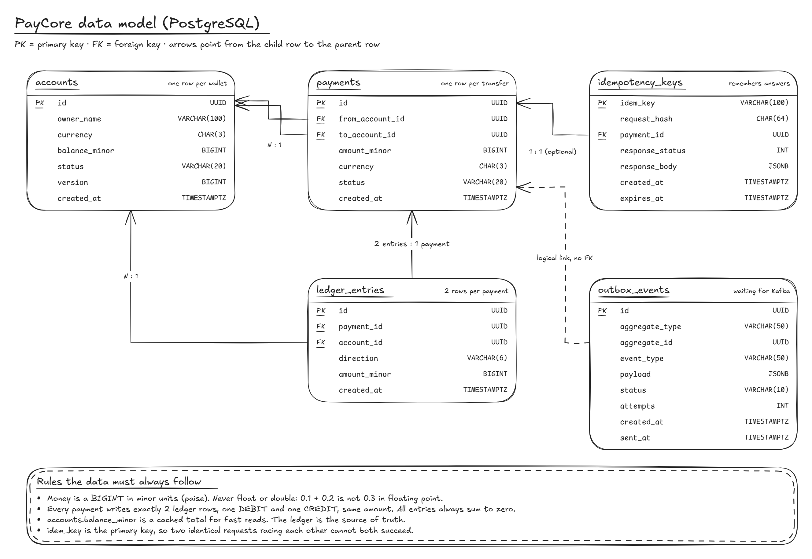

# Data Model

> Table layouts for both products, the rules the data must follow, and a worked example.
> Schema changes will be managed with versioned migrations (Flyway). These diagrams describe the target design.

---

## 1. PayCore (`paycore_db`)

### Tables

| Table | Purpose | Key constraints |
|---|---|---|
| `accounts` | One row per wallet or account. | `currency` is ISO 4217 (e.g. `INR`). `version` supports optimistic checks. `balance_minor` is a cached total. |
| `payments` | One row per money transfer. | `CHECK (amount_minor > 0)` · `CHECK (from_account_id <> to_account_id)` · `status IN ('PENDING','COMPLETED','FAILED')` |
| `ledger_entries` | Immutable money movements. Exactly two per payment. | `direction IN ('DEBIT','CREDIT')` · `UNIQUE (payment_id, direction)` · rows are only inserted, never updated |
| `idempotency_keys` | Remembers each request and its response. | `idem_key` is the PK. `request_hash` detects the same key reused with a different body (reject with `422`). Rows expire after `expires_at`. |
| `outbox_events` | Events waiting to be published to Kafka. | Partial index `WHERE status = 'NEW'` keeps relay polling fast. |

### Invariants (must always hold)

| # | Rule | Enforced by |
|---|---|---|
| 1 | For every payment, the DEBIT amount equals the CREDIT amount. | Service logic plus `UNIQUE (payment_id, direction)` |
| 2 | Across the whole ledger, all DEBITs equal all CREDITs. | Follows from rule 1. Checked by a reconciliation test. |
| 3 | `accounts.balance_minor` equals the sum of that account's ledger entries. | Same transaction. Checked by a reconciliation test. |
| 4 | An `Idempotency-Key` produces at most one payment. | PK on `idem_key` |
| 5 | An event exists in the outbox if and only if its payment committed. | Same transaction |

### Worked example: Asha pays Ravi ₹500

`payments`

| id | from_account_id | to_account_id | amount_minor | currency | status |
|---|---|---|---|---|---|
| `p-1` | `acc-asha` | `acc-ravi` | 50000 | INR | COMPLETED |

`ledger_entries`

| id | payment_id | account_id | direction | amount_minor |
|---|---|---|---|---|
| `l-1` | `p-1` | `acc-asha` | DEBIT | 50000 |
| `l-2` | `p-1` | `acc-ravi` | CREDIT | 50000 |

`outbox_events`

| id | aggregate_type | aggregate_id | event_type | status |
|---|---|---|---|---|
| `e-1` | Payment | `p-1` | PaymentCompleted | NEW → SENT |

`idempotency_keys`

| idem_key | payment_id | response_status |
|---|---|---|
| `7f3c…` | `p-1` | 201 |

₹500 is stored as `50000` paise. All four inserts commit together, or none of them do.

---

## 2. FlagMesh (PostgreSQL, schema `flags`: local Docker now, Neon at deployment)

### Tables

| Table | Purpose | Key constraints |
|---|---|---|
| `flags.feature_flags` | One row per flag. It holds the on/off state, rollout percentage, allowlist (`allow_users`) and any runtime config JSON (`payload`). | `flag_key` is the PK. `CHECK (rollout_pct BETWEEN 0 AND 100)`. `version` increases by exactly 1 on every change. |
| `flags.flag_audit_logs` | Immutable history: the exact before and after JSON of every change, with the `actor` who made it. | `flag_key` is an FK to `feature_flags`. Rows are only inserted, never updated or deleted. |

Both tables, and the four seed flags below, are created by the Flyway migration `V1__init_flags.sql`.

**One environment per database.** There is no `environment` column. Development and production each get their own database (local Docker now, Neon at deployment), so `flag_key` alone stays unique. A shared multi-environment table would need `(flag_key, environment)` as the primary key, an environment filter in every query, and an environment field in every event. That cost buys nothing while there is only one environment per database.

### Seed flags

| `flag_key` | Enabled | Rollout | `payload` | Used for |
|---|---|---|---|---|
| `observability.log-level` | on | 100% | `{"defaultLevel": "INFO", "debugLevel": "DEBUG", "targetUserId": "user_42"}` | Switches the sidecar and the Spring services between INFO and DEBUG logging, live |
| `payment.rate-limit` | on | 100% | `{"requestsPerMinute": 30, "burst": 5}` | Tunes PayCore's Redis token-bucket rate limit |
| `payment.kill-switch` | off | 0% | `{"retryAfterSeconds": 60, "reason": "Scheduled maintenance"}` | Stops payments during maintenance |
| `payment.fraud-v2` | on | 25% | `{"riskScoreThreshold": 0.75, "timeoutMs": 150}` | Rolls out the new fraud check to 25% of users |

### How a flag is evaluated (in the sidecar)

| Step | Condition | Result | `reason` |
|---|---|---|---|
| 1 | Flag missing, or `enabled = false` | Off, `payload: null` | `REASON_DISABLED` |
| 2 | `userId` is in `allow_users` | On, with the payload | `REASON_TARGETED` |
| 3 | `murmur3.Sum32(flagKey + ":" + userId) % 100 < rollout_pct` | On, with the payload | `REASON_PERCENTAGE_ROLLOUT` |
| 4 | Otherwise (user is outside the rollout) | Off, `payload: null` | `REASON_DEFAULT` |

The hash is deterministic, so the same user always gets the same answer. Raising `rollout_pct` from 20 to 50 keeps every user who was already on.

### Evaluate API (sidecar)

`POST http://localhost:9090/v1/evaluate`

| Request field | Type | Notes |
|---|---|---|
| `flagKey` | string | e.g. `payment.rate-limit` |
| `userId` | string | Used for the allowlist and for bucketing |

| Response field | Type | Notes |
|---|---|---|
| `flagKey` | string | Echoed back |
| `enabled` | boolean | The final decision |
| `reason` | string | `REASON_DISABLED`, `REASON_TARGETED`, `REASON_PERCENTAGE_ROLLOUT` or `REASON_DEFAULT`. The names follow OpenFeature's standard reasons (`DISABLED`, `TARGETING_MATCH`, `SPLIT`, `DEFAULT`). |
| `version` | int64 | The flag version that produced the answer |
| `payload` | JSON object | The runtime config, e.g. `{"requestsPerMinute": 30, "burst": 5}` |

The sidecar also exposes `GET /health`.

### Shared contract (Java ↔ Go)

The Redis event (`FlagUpdateEvent` on channel `flags:updates`) and the snapshot from `GET /api/internal/flags/snapshot` carry the same flag fields. Java defines them as records in `control-plane/.../model/`, and Go as structs in `sidecar/models.go`. Both live in the `flagmesh` repo, so they cannot drift apart unnoticed.

| Field | Type | Notes |
|---|---|---|
| `flagKey` | string | Primary key, dotted name (`payment.rate-limit`) |
| `enabled` | boolean | Master switch |
| `rolloutPct` | int 0–100 | Percentage rollout |
| `allowUsers` | string array | Always-on user IDs |
| `payload` | JSON object | Runtime config returned to the caller |
| `version` | int64 | Monotonic. The sidecar ignores any event whose version is not newer than the one it holds. |

---

## Editing the diagrams

Each `diagrams/*.png` is an Excalidraw export with the scene embedded inside the image. To edit one, drag the PNG into [excalidraw.com](https://excalidraw.com). After editing, export it as PNG with **Embed scene** ticked, and keep the same file name.
