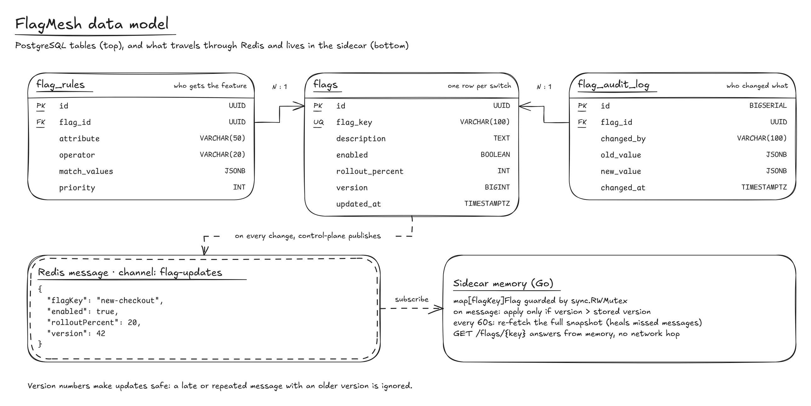

# Data Model

> Table layouts for both products, the rules the data must follow, and a worked example.
> Schema changes will be managed with versioned migrations (Flyway). These diagrams describe the target design.

---

## 1. PayCore (`paycore_db`)

### Tables

| Table | Purpose | Key constraints |
|---|---|---|
| `accounts` | One row per wallet or account. | `currency` is ISO 4217 (e.g. `INR`). `version` supports optimistic checks. `balance_minor` is a cached total. |
| `payments` | One row per money transfer. | `CHECK (amount_minor > 0)` · `CHECK (from_account_id <> to_account_id)` · `status IN ('PENDING','COMPLETED','FAILED')` |
| `ledger_entries` | Immutable money movements. Exactly two per payment. | `direction IN ('DEBIT','CREDIT')` · `UNIQUE (payment_id, direction)` · rows are only inserted, never updated |
| `idempotency_keys` | Remembers each request and its response. | `idem_key` is the PK. `request_hash` detects the same key reused with a different body (reject with `422`). Rows expire after `expires_at`. |
| `outbox_events` | Events waiting to be published to Kafka. | Partial index `WHERE status = 'NEW'` keeps relay polling fast. |

### Invariants (must always hold)

| # | Rule | Enforced by |
|---|---|---|
| 1 | For every payment, the DEBIT amount equals the CREDIT amount. | Service logic plus `UNIQUE (payment_id, direction)` |
| 2 | Across the whole ledger, all DEBITs equal all CREDITs. | Follows from rule 1. Checked by a reconciliation test. |
| 3 | `accounts.balance_minor` equals the sum of that account's ledger entries. | Same transaction. Checked by a reconciliation test. |
| 4 | An `Idempotency-Key` produces at most one payment. | PK on `idem_key` |
| 5 | An event exists in the outbox if and only if its payment committed. | Same transaction |

### Worked example: Asha pays Ravi ₹500

`payments`

| id | from_account_id | to_account_id | amount_minor | currency | status |
|---|---|---|---|---|---|
| `p-1` | `acc-asha` | `acc-ravi` | 50000 | INR | COMPLETED |

`ledger_entries`

| id | payment_id | account_id | direction | amount_minor |
|---|---|---|---|---|
| `l-1` | `p-1` | `acc-asha` | DEBIT | 50000 |
| `l-2` | `p-1` | `acc-ravi` | CREDIT | 50000 |

`outbox_events`

| id | aggregate_type | aggregate_id | event_type | status |
|---|---|---|---|---|
| `e-1` | Payment | `p-1` | PaymentCompleted | NEW → SENT |

`idempotency_keys`

| idem_key | payment_id | response_status |
|---|---|---|
| `7f3c…` | `p-1` | 201 |

₹500 is stored as `50000` paise. All four inserts commit together, or none of them do.

---

## 2. FlagMesh (`flagmesh_db`)

### Tables

| Table | Purpose | Key constraints |
|---|---|---|
| `flags` | One row per feature switch. | `flag_key` unique. `CHECK (rollout_percent BETWEEN 0 AND 100)`. `version` increments on every change. |
| `flag_rules` | Targeting rules (e.g. `country IN ['IN']`). | Evaluated in `priority` order. The first match wins. |
| `flag_audit_log` | Append-only history of who changed what. | Rows are never updated or deleted. |

### How a flag is evaluated (in the sidecar)

| Step | Logic |
|---|---|
| 1 | `enabled = false`: the flag is **off** for everyone. |
| 2 | A matching rule exists: use the rule's result. |
| 3 | Otherwise, compute `hash(flagKey + userId) % 100`. If it is less than `rollout_percent`, the flag is **on**. The same user always gets the same answer. |

### Shared contract (Java ↔ Go)

The Redis message and the snapshot JSON share one schema. It lives in the `flagmesh` repo and is used by both `control-plane` and `sidecar`, so the two cannot drift apart.

| Field | Type | Notes |
|---|---|---|
| `flagKey` | string | Unique, kebab-case |
| `enabled` | boolean | Master switch |
| `rolloutPercent` | int 0–100 | Percentage rollout |
| `rules` | array | Optional targeting rules |
| `version` | int64 | Monotonic. The sidecar ignores any message whose version is not newer than the one it holds. |

---

## Editing the diagrams

Each `diagrams/*.png` is an Excalidraw export with the scene embedded inside the image. To edit one, drag the PNG into [excalidraw.com](https://excalidraw.com). After editing, export it as PNG with **Embed scene** ticked, and keep the same file name.
